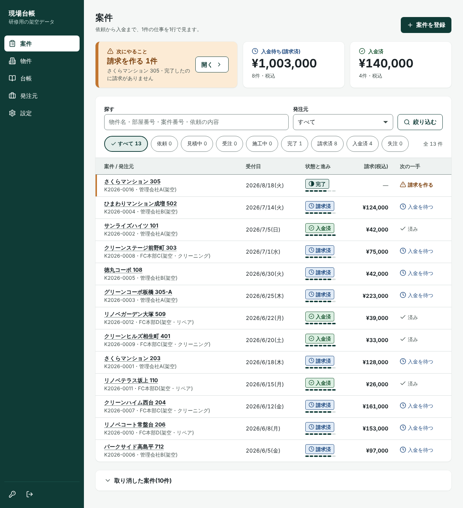
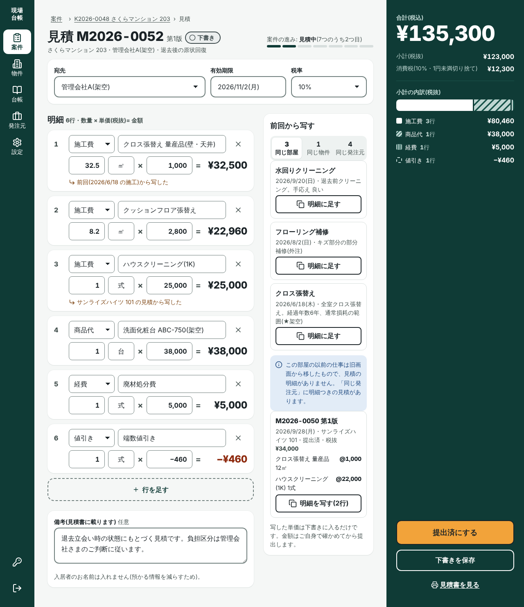
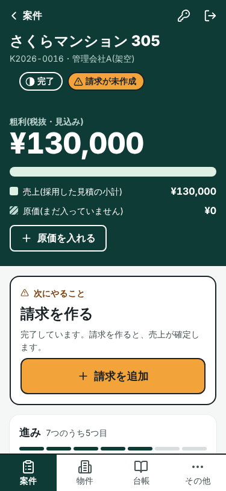
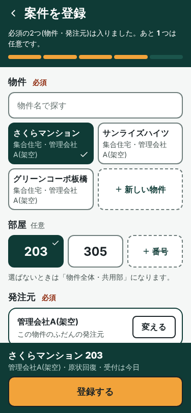

# 現場台帳(PoC)|原状回復・小規模リフォームの依頼〜見積〜施工〜請求〜入金を1本でつなぐ業務アプリ

## これは何か

AI 導入コンサルの研修課題として作った PoC(試作)です。対象は、首都圏で原状回復・小規模リフォームを請け負う小規模事業者を想定しています。

**実在の事業者への導入事例ではありません。** 画面とデータはすべて架空で、発注元などには「(架空)」のラベルを付けています。

本番の URL は https://genba-daicho-poc.vercel.app です。研修で見せるために置いているもので、ログインが必要です。サインアップは止めてあるため、第三者は登録できません(検索にも載らない設定です)。

## できること

- **物件と部屋のマスター**: 建物を1つ登録し、その中の部屋を持つ。過去の仕事を物件・部屋から引ける
- **案件**: 依頼から入金までを1件として持つ。登録はスマホで3タップ。一覧はフィルターで絞れ、状態の流れと「次の一手」(請求を作る・入金を待つ など)が1行で見える
- **施工の記録**: 案件の画面から2タップで記録する
- **見積**: 明細(施工費・商品代・経費・値引き)と税の計算、版の管理。前回の見積と施工を横に並べ、明細を写せる。A4 の見積書を印刷できる
- **見積から請求**: 採用した見積の金額・税率をそのまま請求に写す
- **原価と粗利**: 外注費・材料費・経費を入れると、案件ごとの粗利(税抜)が出る
- **事業者情報**: 見積書に載せる屋号・住所・振込先などを1か所で持つ
- **「請求が未作成」の気づき**: 完了したのに請求が無い案件を一覧の頭に出す
- **台帳**: 請求と入金の記録・集計(この部分は前の版(v1)の画面のまま)

ほかの施工管理アプリにも、案件・見積・請求を扱う機能はあります。この PoC は、小規模事業者の事務の流れを1本でつなぐ形を、研修の中で試したものです。

## 画面

下の4枚は、実装の見本にしたデザイン案(Claude Design で作成)です。実際の画面は、この案をもとに組み直したもので、細部が違います(採用したのは「数字を先に見せる案」に、表の作りだけ別の案を合わせた形)。データはすべて架空です。

| 案件の一覧(PC) | 見積の編集(PC) |
|---|---|
|  |  |

| 案件の詳細(スマホ) | 案件の登録(スマホ) |
|---|---|
|  |  |

## 設計で決めたこと

- **案件を軸にする(地図は使わない)**: 毎日の事務は「どの仕事がいまどこまで進んだか」から始まるため、入口を案件の一覧にした。
- **状態は「人が動かす6つ+計算で出す2つ」**: 依頼・見積中・受注・施工中・完了・失注は人が動かす。請求済・入金済は請求と入金の記録から計算する。請求済・入金済まで列に持つと、請求を取り消したときや一部だけ入金されたときに、実際の記録とずれる。
- **見積は提出したら書き換えず、版を増やす**: 発注元に出した金額を、あとから追えるようにした。
- **金額は税抜の整数の円。税は合計に1回だけ計算し、端数は切り捨て**: 明細ごとに税を足すとずれが出るため。切り捨ては発注元に不利にならず、説明しやすい。
- **削除は論理削除にし、変更は監査ログに残す**: 「間違えたら直す」を前提にした PoC なので、訂正の履歴を必ず追えるようにした。
- **データを守る境界は RLS だけに置く**: ブラウザから Supabase を直接呼ぶ構成なので、ほかに守りが無い。未ログイン(anon)には何の権限も与えず、ログインした人にも DELETE の権限は与えない。
- **入居者名・発注元の担当者名は持たない**: 管理会社側の情報を職人側のツールに持つことの是非が確かめられていないため。持たなければ漏れない。

## 技術

- Next.js 15(App Router・Server Actions)
- Supabase(Postgres・Auth・RLS)
- shadcn/ui+Tailwind CSS v4
- zod(サーバー側の入力の検証)
- TanStack Table(一覧の表)
- デザインの土台は [`docs/DESIGN-SYSTEM.md`](docs/DESIGN-SYSTEM.md)。デジタル庁デザインシステムと SmartHR Design System の考え方を参考にした

## 動かし方

開発者向けの手順です。Supabase のプロジェクトを1つ用意してください。

1. `npm install`
2. `.env.example` を `.env.local` に写し、Supabase の URL と anon key を入れる(値は README やコミットに書かない。`service_role` キーは使わない)
3. Supabase の SQL エディタで、次の順に流す
   1. `supabase/schema_poc.sql`(元になる表・ビュー・RLS)
   2. `supabase/seed_poc.sql`(架空のデモデータ)
   3. `supabase/migration_002_revoke_delete.sql` → `migration_003_audit_sites_clients.sql`
   4. `migration_005` → `006` → `007` → `008` → `009` の順。それぞれ、先に同じ番号の `_dryrun.sql`(最後に rollback する予行演習)を流して確認してから本体を流す。`migration_005` が、seed の現場のデータを物件と部屋に移す
4. Supabase の Authentication で、サインアップを止め、Users からログインに使うユーザーを作る(アプリにサインアップの画面は無い)
5. `npm run dev` で起動し、http://localhost:3000 でログインする

戻すときは `supabase/rollback_*.sql` を番号の逆順に流します。公開の手順(Vercel の設定・環境変数)は [`docs/deploy-runbook.md`](docs/deploy-runbook.md) にあります。

## ドキュメント

| ファイル | 内容 |
|---|---|
| [`docs/HANDOVER.md`](docs/HANDOVER.md) | 引き継ぎ。いまの状態・本番に入っているもの・やらなかったこと |
| [`docs/SPEC-v2.md`](docs/SPEC-v2.md) | 仕様。範囲・用語・データモデル・金額と税・画面 |
| [`docs/architecture.md`](docs/architecture.md) | 構成と信頼境界。どこで何を検証しているか |
| [`docs/DESIGN-SYSTEM.md`](docs/DESIGN-SYSTEM.md) | 見た目の決まり。原則・色と文字・部品・文言 |
| [`docs/deploy-runbook.md`](docs/deploy-runbook.md) | 公開の手順。環境変数・Supabase の設定・Vercel・戻し方 |
| [`docs/test-scenarios.md`](docs/test-scenarios.md) | 確かめる手順と結果 |
| [`docs/issue-log.md`](docs/issue-log.md) | 見つかった不具合と対応 |
| [`docs/change-log.md`](docs/change-log.md) | 仕様・スキーマの変更の記録 |

## 作り方の記録

進め方を決める役(PM)のスレッドと、作業をするスレッドを分け、指示書(WO)→ 報告 → 受入の形で進めました。判断は番号を付けて記録しています。研修で使った進め方の報告は別のリポジトリにあり、ここには置いていません。

## ライセンス・利用について

ライセンスは付けていません(著作権法上、許可のない再利用はできません)。
閲覧・参考にするのは歓迎します。コードを再利用したい場合は、GitHub の Issue でご相談ください。

---

この README は 2026-10-26 に書き直しました。以前の README(このリポジトリの前の用途の説明)は `git log` で見られます。
