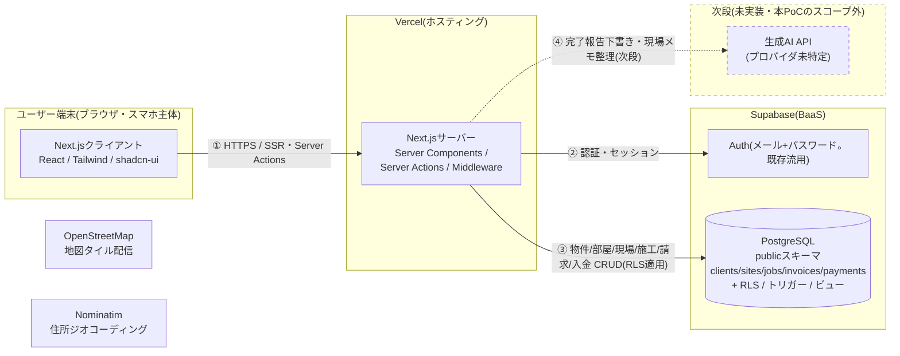

# システム構成図(現場台帳 v2: 物件・部屋の基盤。WO-011 段階1)

生成日: 2026-09-24(初版・アーキテクト作成) / 対象: `poc-app/`(`rebuild` ブランチ。flyer-tracker 由来の画面と地図は外した=D79・D80)
関連: `docs/SPEC.md`(データモデル・画面・API一覧)、`supabase/schema_poc.sql`(DDL)

**実装を変更したら、同じコミットでこの図も更新すること**(`CLAUDE.md`参照)。

## 全体構成

## コンポーネント

| コンポーネント | 役割 | 実行場所 |
|---|---|---|
| `src/app/(main)/page.tsx` | `/buildings` へ転送(入口は一覧。段階2 で `/cases` に替える) | サーバー |
| `src/app/(main)/buildings/page.tsx`(段階1) | 物件の一覧+フィルター(`?q=`・`?kind=`・`?client=`・`?sort=`)。`building_overview` ビューだけを読む(`select *` なし)。語句は物件名・住所・メモ・部屋番号の部分一致(`queries-buildings.ts` の `findBuildingIdsByText`。列ごとに `.ilike`、入力は zod で検証・エスケープ)。絞り込みは URL のクエリ、サーバー側で実行。表は `components/buildings/buildings-table.tsx`(TanStack Table。スマホ幅でカードに切り替わる) | サーバー(Server Components)+クライアント(表) |
| `src/app/(main)/buildings/new/page.tsx`・`[id]/page.tsx`・`[id]/edit/page.tsx`(段階1) | 物件の登録(名前が似ている物件を先に出す・部屋なし可・位置の入力欄は無い=D80)/ 詳細(部屋ごとに、v1 から移した施工と請求を新しい順に。`getUnitHistories` が `units.legacy_site_id` 経由で jobs と `invoice_ledger` を読む)/ 編集 | サーバー+クライアント(フォーム) |
| `src/app/(main)/sites/[id]/page.tsx`(新設) | ②現場詳細。施工履歴・前回施工日の照会・同じ建物(建物名完全一致・削除済み除く)の他の部屋の一覧(`getSiblingSites`。CHANGE-A-019)・施工の登録編集・その現場の請求一覧・現場自体の論理削除/復元(ISSUE-008対応・CHANGE-A-015)。`getSiteById`は`is_deleted`で絞っていないため、削除済み現場も404にせず取得でき、画面上部に削除済みバナー+復元ボタンを出す。削除時は`setSiteDeletedAction`内の`redirect("/")`で地図へ遷移(CHANGE-A-011と同じ理由)、復元時は同じページに留まり`router.refresh()`で反映 | サーバー(Server Components)+クライアント(削除/復元ボタン) |
| `src/app/(main)/ledger/page.tsx`(新設) | ③台帳。`invoice_ledger`ビューを発注元別・集客経路別・月次で集計。未入金候補の一覧。請求・入金の登録編集 | サーバー(Server Components) |
| `src/app/(main)/clients/page.tsx`(新設) | ④発注元マスタ。追加・編集 | サーバー(Server Components) |
| `src/app/login/page.tsx` | ⑤ログイン。既存のSupabase Auth(メール+パスワード)をそのまま流用、変更なし | クライアント(ブラウザ) |
| `src/lib/data/actions-buildings.ts` / `queries-buildings.ts` / `validation/building.ts`(段階1) | 物件・部屋の Server Actions(登録は物件→部屋の順に insert。部屋の insert に失敗したら物件を論理削除して戻す)と読み取り。入力は zod で検証。`lat`/`lng`/`geo_source` は書かない(D80) | サーバー |
| `src/app/(main)/cases/page.tsx` / `new/page.tsx` / `[id]/page.tsx`(段階2) | 案件の一覧+フィルター(`?q=`・`?status=`・`?client=`・`?attention=`。`case_overview` ビューだけを読む)/ 案件の登録(スマホ1分。`CaseQuickForm`)/ 案件の詳細(状態・施工・請求・入金。施工と請求は案件の `sites` 行(`case.site_id`)に付く v1 の部品をそのまま使う) | サーバー+クライアント |
| `src/lib/data/actions-cases.ts` / `queries-cases.ts` / `validation/case.ts`(段階2) | 案件の Server Actions(登録は物件・部屋を同時に作れる。失敗したら作った物件・部屋を論理削除で戻す。状態の変更。取り消し/元に戻す。DB のトリガーが出した理由を画面に返す)と読み取り。`findCaseIdBySite` は、v1 の施工・請求の登録が案件に結びつけるために使う。入力は zod で検証 | サーバー |
| `src/app/(main)/cases/[id]/jobs/new/page.tsx` / `cases/[id]/edit/page.tsx`(段階2・D89) | 施工の記録(スマホ1分。`CaseJobQuickForm` → `createJobAction`)/ 案件の編集(`CaseEditForm` → `updateCaseAction`。物件・部屋は変えない) | サーバー+クライアント |
| `src/components/app-nav.tsx`・`src/app/v2.css`(段階1) | 画面の骨組み(PC は左の深緑のメニュー、スマホは上の帯と下のナビ)とデザインのトークン・部品の CSS。正は `docs/DESIGN.md`。フォーカスの輪の色などはデジタル庁デザインシステムのトークン(`@digital-go-jp/design-tokens` 2.0.1・MIT)の値 | クライアント(ナビ)/ CSS |
| `src/lib/data/actions-sites.ts`(新設・実装A) | 発注元・現場・施工のServer Actions。zodで入力検証してからSupabaseへ | サーバー |
| `src/lib/data/actions-ledger.ts`(新設・実装B) | 請求・入金のServer Actions。zodで入力検証してからSupabaseへ | サーバー |
| `src/lib/data/queries-sites.ts` / `queries-ledger.ts`(新設) | 現場一覧・現場検索・同じ建物の現場・現場ごとの前回施工・`site_status`・`invoice_ledger`の取得(`select *`は使わない。前回施工は jobs 全件取得でPoC規模前提) | サーバー(Server Components) |
| `src/lib/validation/site.ts` / `invoice.ts`(新設) | zodスキーマ(サーバー側入力検証の唯一の定義元) | 共有(サーバー/クライアント両方からimport可) |
| `src/lib/types.ts` | 既存の型定義に、本PoCの型(`Client`/`Site`/`Job`/`Invoice`/`Payment`等)を追記して集約 | 共有 |
| `src/lib/supabase/client.ts` / `server.ts` | 既存のSupabaseクライアント(anon keyのみ使用)をそのまま流用 | クライアント/サーバー |
| `src/middleware.ts` | 既存の認証チェック(未ログインは`/login`へリダイレクト)をそのまま流用、変更なし | サーバー(リクエストの前段) |
| `supabase/migration_005_buildings_units.sql` / `migration_005_dryrun.sql` / `rollback_005.sql`(段階1) | 物件(`buildings`)・部屋(`units`)・`building_overview` ビュー、監査トリガー、RLS(DELETE なし)、sites からの移行。予行演習用(最後に rollback)と本番用(commit)を分けた。**DBには未適用** | Supabase(Postgres) |
| `supabase/migration_006_cases.sql` / `migration_006_dryrun.sql` / `rollback_006.sql`(段階2・D87 案A) | 案件(`cases`)・採番(`doc_counters`・`next_doc_no()`)・`case_overview` ビュー、`jobs.case_id`・`invoices.case_id`。案件を作るとトリガーが `sites` 行を1つ作り(`cases.site_id`)、施工・請求の `site_id` は案件のものに揃う。物件・部屋・案件を直すと `sites` に写る。v1 のビューと NOT NULL は変えない。予行演習は確認用の案件でトリガーも試す。**DBには未適用**。段階4 で `sites` への依存を外す(SPEC-v2 §12) | Supabase(Postgres) |
| `supabase/migration_007_building_overview_cases.sql` / `migration_007_dryrun.sql` / `rollback_007.sql`(段階2) | `building_overview` の `job_count`・`last_job_date` を案件から数える。`case_count` 列を足す。**DBには未適用** | Supabase(Postgres) |
| `supabase/migration_008_estimates.sql` / `migration_008_dryrun.sql` / `rollback_008.sql`(段階3・D94) | 見積(`estimates`)と明細(`estimate_items`)、`invoices.estimate_id`・`tax_rate_pct`。明細の金額・見積の小計/税/合計はトリガーが計算(税は小計に1回・0方向に切り捨て)。提出済以降は DB が書き換えを断る(出し直しで版を増やす)。採用は1案件に1つ。見積から作る請求は金額・税率を見積から写し、あとから直せない(1見積=1請求)。明細の保存・前回の見積の写し・出し直しは関数(`save_estimate_items`・`copy_estimate_items`・`reissue_estimate`。security invoker・authenticated のみ実行可)。明細は論理削除で、行ごとの監査ログは無い。**DBには未適用** | Supabase(Postgres) |
| `supabase/migration_009_costs_profile.sql` / `migration_009_dryrun.sql` / `rollback_009.sql` / `check_after_009.sql`(段階3・D94・D96) | 原価(`costs`・税抜の整数円・論理削除)、事業者情報(`business_profile`・1行だけ。`singleton` の unique。架空の値を1行入れる)、ビュー `case_financials`(案件1行。粗利は税抜 = 売上(税抜)− 原価(税抜)。売上は 請求(見積由来の請求の小計)/ 見込み(採用した見積の小計)/ 内訳なし(見積に結びつかない請求がある)/ 未定。`case_overview` は変えない)。**DBには未適用** | Supabase(Postgres) |
| `supabase/schema_poc.sql` / `rollback_poc.sql` | `clients`/`sites`/`jobs`/`invoices`/`payments`/`audit_logs`テーブル、`site_status`/`invoice_ledger`ビュー、RLSポリシー、監査トリガーを定義する冪等なDDL。db-changeスキルの方針に従う | Supabase(Postgres) |
| `supabase/seed_poc.sql`(新設・実装B) | 想定利用者(仮想)の架空デモデータ(発注元4・現場12・施工30・請求20・入金15)。PM決定(D38-5)によりデモスキーマの代わりにこれを使う | Supabase(Postgres)。DBには未適用(未確認) |
| `src/components/ledger/site-invoices-panel.tsx`(新設・実装B) | ②現場詳細に差し込む「請求・入金」パネル。`siteId`/`buildingName`だけを受け取り、`invoice_ledger`の取得を自前で行う自己完結の非同期Server Component。実装Aの`src/app/(main)/sites/[id]/page.tsx`から`children`として呼ばれる(CHANGE-A-008) | サーバー(Server Components)。内部の`InvoiceItem`/`PaymentList`等はクライアントコンポーネント |
| `src/components/ledger/audit-log-dialog.tsx`(新設・実装B) | jobs/invoices/payments共通の変更履歴ダイアログ。既存の`VisitLogDialog`パターンを一般化し、`getAuditLogsAction`を呼ぶ。実装Aの施工履歴(`job-log-dialog.tsx`)からも同じ`getAuditLogsAction`を呼ぶ想定 | クライアント |

## データフローと信頼境界

| 境界 | 検証方法 | 理由 |
|---|---|---|
| ブラウザ → Server Actions(①) | zodスキーマ(`src/lib/validation/*`)による`safeParse` | クライアントから来る値を無条件に信用しない(共通CLAUDE.md方針)。金額・日付・enum値をここで弾く |
| Server Actions → Supabase(②③) | **RLS**(`supabase/schema_poc.sql`)。`clients`/`sites`/`jobs`/`invoices`/`payments`/`audit_logs`はすべて`authenticated`ロールのみ参照・更新可、`anon`は一切不可。`jobs`/`invoices`/`payments`は物理DELETE権限を付与しない(論理削除のみ) | Supabaseはクライアント(Server Actions経由だがservice_roleは使わない)が直接DBを叩く構成のため、**RLSが唯一のアクセス制御**(db-changeスキル原則7)。既存`schema.sql`と同じモデルを踏襲 |
| Supabase → Server Components(③) | `site_status`/`invoice_ledger`ビュー(`security_invoker=on`)を経由し、必要な列だけselect | 内部テーブルではなくビューを公開契約にする(db-change原則6)。内部のJOIN・集計ロジックを変えても画面側のクエリは壊れない |
| Server Actions → Supabase(監査ログ) | `log_entity_changes()`トリガー(`security definer`)が`jobs`/`invoices`/`payments`への変更を自動的に`audit_logs`へ記録。`sites`/`clients`向けのトリガー(`trg_sites_log`/`trg_clients_log`。関数は同じものを流用、変更なし)は`supabase/migration_003_audit_sites_clients.sql`として作成済みだが**DBには未適用**(PM決定A-3・SPEC.md §12。適用はユーザー判断)。適用すると`audit_logs.entity_type`の許容値も`'sites'`/`'clients'`まで広がる(同マイグレーションでCHECK制約を変更)。適用後も現場・発注元の変更履歴を見るUIは未実装(次段の課題) | クライアント・Server Actionsのコード側で記録し忘れる余地をなくすため、DB側のトリガーで強制する(既存`visit_logs`と同じ設計)。`sites`/`clients`にトリガーが無い状態は、本PoCの差別化の核「訂正履歴を必ず追える」(poc-app/CLAUDE.md §4)と食い違うため追加した(CHANGE-A-016) |
| Server → 生成AI API(④・次段) | 未実装。実装時は住所・部屋番号・入居者名・発注元担当者名を送らない設計にする(`docs/SPEC.md` §8) | 児童・入居者等の第三者に関わる情報を外部APIに送るリスクを避けるため、送信範囲を先に決めてから実装する |

## 認証・アクセス範囲の設計

- **ログイン方式**: 既存のSupabase Auth(メール+パスワード)をそのまま流用。変更なし。
- **共有範囲**: 単一事業者・少人数チーム全員が、`clients`/`sites`/`jobs`/`invoices`/
  `payments`をすべて閲覧・編集できる(行ごとのユーザー分離はしない)。既存`schools`/
  `locations`/`visits`と同じ「チームで共有・相互編集」モデル。
- **複数事業者での共用は現状スコープ外**。将来必要になった場合は`tenant_id`列と
  ポリシーの拡張が要る(`docs/SPEC.md` §12参照)。

## 機密情報の扱い

- `NEXT_PUBLIC_SUPABASE_URL` / `NEXT_PUBLIC_SUPABASE_ANON_KEY`はクライアントに公開される
  前提の値。実際のアクセス制御はRLSが担うため、この2つが漏れても即座にデータ漏洩には
  ならない。
- `service_role`キーはこのアプリでは一切使用しない。
- 次段でLLM機能を導入する場合、`OPENAI_API_KEY`(または他プロバイダの鍵)はサーバー側
  (`app/api/**`)でのみ`process.env`から読み、クライアントに一切渡さない設計にする。

## 本番の構成(Vercel・WO-008)

- 構成: GitHub(private リポジトリ `genba-daicho-poc`)→ Vercel(Next.js をビルド・配信)→ Supabase(認証・DB)。ブラウザは Vercel の公開 URL に来て、ログイン後に Supabase を直接呼ぶ(従来の信頼境界のまま)。
- 環境変数は `NEXT_PUBLIC_SUPABASE_URL` / `NEXT_PUBLIC_SUPABASE_ANON_KEY` の2つだけ(Vercel の Production・Preview に設定)。値は docs に書かない。
- 公開前提のため、**RLS は「ログイン済みなら全件読める」設計**であることに注意。Supabase の新規ユーザーのサインアップを止めておくことが前提(止めないと第三者が登録して読める)。手順は `docs/deploy-runbook.md`。
- middleware は本番で環境変数が欠けたら 500 を返す(CHANGE-D-001)。`/list`・`/schools` は `/` に戻す(CHANGE-D-002)。`robots` は noindex(CHANGE-D-003)。

## 未解決のリスク・保留事項

1. **物件住所・入居者に関わる情報を職人側のツールに持つことの是非**は正面から扱う
   Q&Aを別途用意する(`poc-design.html` §7)。本設計では入居者名・発注元担当者名の列を
   作らないことで最小化しているが、住所(建物名・部屋番号)自体は保持する。
2. **請求の粒度(1請求=1現場か、複数現場をまとめた月次請求か)**が未確定
   (`docs/SPEC.md` §12-1)。現在のスキーマは前者を前提にしている。
3. **チラシ配布ドメイン(既存画面)とのUI共存**が未確定(`docs/SPEC.md` §12-2)。
4. **(解消)地図とチラシ配布の画面は `rebuild` ブランチで外した**(D79-3・D80)。Leaflet と react-leaflet は依存から外し、`/list`・`/schools`・デモ表示モードも撤去した。本番(`main`)は受入まで変わらない。
5. **発注元(clients)の論理削除アクション(`setClientDeletedAction`)は実装Aが追加した**。
   SPEC.md §7の一覧には存在しないが、§10④の受入条件(発注元に紐づく現場がある場合は
   削除できない)を満たすために必要と判断した。物理DELETEは行わず、紐づく現場が
   1件以上ある場合はエラーを返す(サーバー側ガード)。
6. **請求・入金の論理削除の「理由メモ」は、`log_entity_changes`トリガーを変更せずに
   2段階UPDATEで実現した**(実装B・`actions-ledger.ts`)。トリガーは
   `is_deleted: false→true`のUPDATEを`action='delete'`として記録し、その際
   `after_data`をnullにする設計(schema_poc.sql)のため、削除理由をmemoに先に反映してから
   is_deletedを立てる2回のUPDATEに分けることで、`delete`ログの`before_data.memo`に
   理由が残るようにしている。トリガー自体(共有スキーマ)は変更していない。将来、
   `delete_reason`列を追加するような設計に変える場合はPMの判断を仰ぐ
   (`docs/SPEC.md` §12-3、入金の取消・訂正の運用は未確定のまま)。
7. **`supabase/seed_poc.sql`(架空データ)はDB未接続のため未検証**。カラム名・CHECK制約・
   NOT NULL制約は`schema_poc.sql`と目視で突き合わせたが、実際にSupabaseへ流して
   エラーが出ないかは未確認(実装B)。
